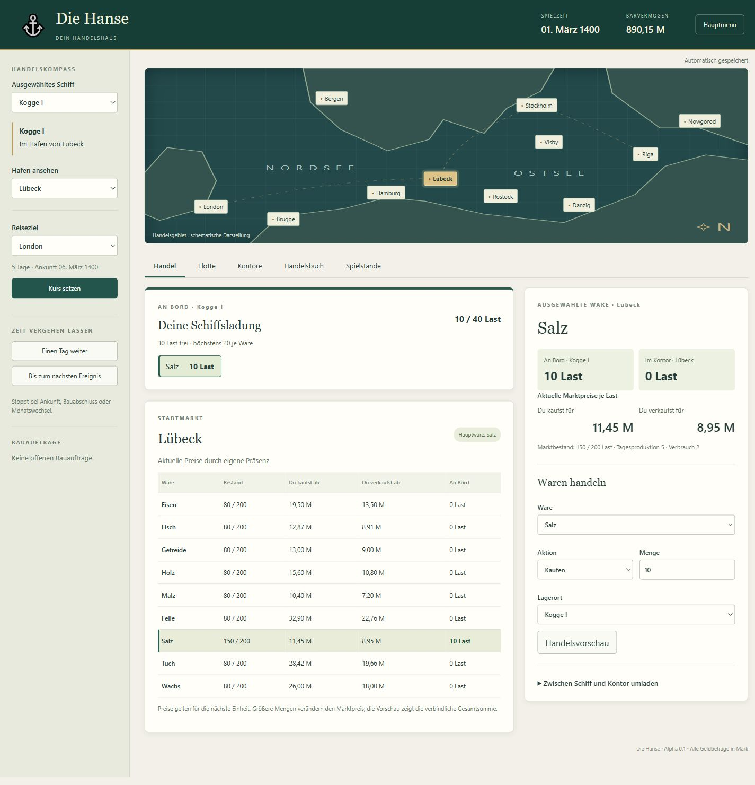
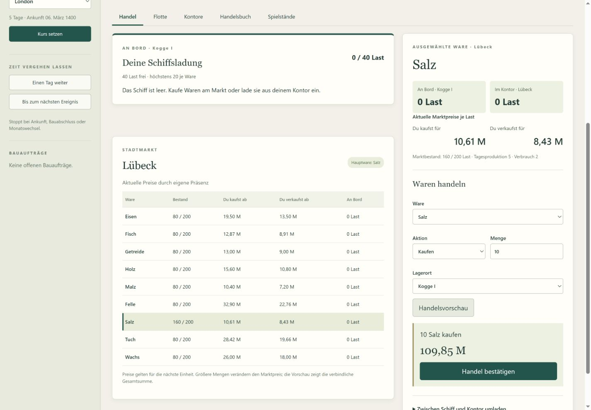
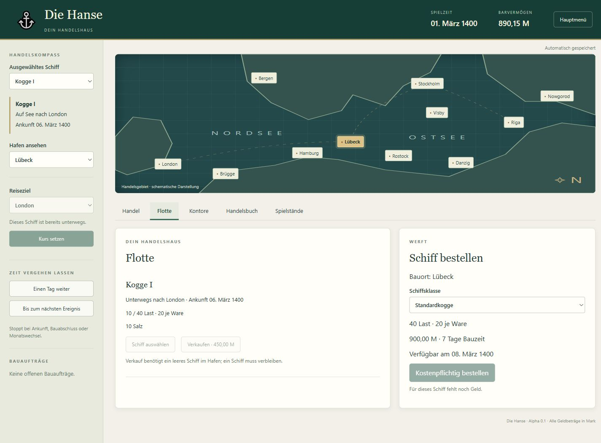

# Die Hanse

Historische Handelssimulation für Windows: vom Lübecker Kaufmann zum eigenen Handelshaus.

**[0.1.0-alpha.2 – öffentliche Vorabversion](https://github.com/OnekoSL/die-hanse/releases/tag/v0.1.0-alpha.2).** Die Basis verbindet zwei Prototypen: elf Häfen, neun Grundwaren, freie Handelsfahrten, Kontore, Schiffsbau, Monatsberichte und benannte Spielstände.

[Änderungen in Alpha 2](docs/aenderungen.md): direkte Warendetails und vollständige Schiffsladung.

## Einblicke ins Spiel

Die Bilder zeigen die aktuelle Vorabversion **0.1.0-alpha.2**.

**Häfen erkunden und Waren handeln:** Die Karte verbindet elf Häfen. In der Handelsansicht stehen Marktbestände, Kauf- und Verkaufspreise sowie die eigene Schiffsladung nebeneinander. Hier liegen zehn Last Salz für die nächste Fahrt in der Lübecker Kogge.

**Den Gesamtpreis vor dem Handel prüfen:** Die Handelsvorschau berechnet die gesamte gewählte Menge. Erst mit der Bestätigung wird der Kauf oder Verkauf ausgeführt.

**Reisen planen und die Flotte ausbauen:** Die Flottenansicht zeigt Ladung und Ankunftsdatum der eigenen Schiffe. In der Werft lassen sich zusätzliche Schiffe mit ausgewiesenen Kosten und Bauzeiten bestellen. Diese Kogge fährt gerade von Lübeck nach London.

## Spielen

Vorabversionen: [GitHub Releases](https://github.com/OnekoSL/die-hanse/releases). Den Windows-x64-MSI installieren und **Die Hanse** starten. Python und Node.js sind zum Spielen nicht erforderlich. Windows benötigt die Microsoft WebView2 Runtime; der Installer berücksichtigt diese Voraussetzung. Nach Installation ist das Spiel offline nutzbar.

Start am 1. März 1400 mit 1.000 Mark, einer Standardkogge und einem Lübecker Kontor. Zum Einstieg zehn Last Salz kaufen, nach London reisen und dort verkaufen. Die Handelsvorschau zeigt vor der Bestätigung die Gesamtsumme.

Jede erfolgreiche Aktion wird automatisch gespeichert. Unter „Spielstände“ zusätzliche benannte Stände anlegen und ausdrücklich überschreiben. Eigene Daten: `%AppData%/com.onekosl.diehanse/data/hanse.db`. Die Vorgänger-Spielstände bleiben unberührt; Import folgt später.

## Entwicklung

Python 3.11, Node.js 22; für Windows-Builds zusätzlich Rust und Visual Studio mit C++/Windows SDK. Abhängigkeiten sind über Constraints und Lockdateien festgelegt.

- [Dokumentation](docs/README.md), [Spielregeln](docs/spielkonzept.md), [Architektur](docs/architektur.md)
- [Roadmap](docs/roadmap.md), [Beschlüsse](docs/entscheidungen.md), [Abnahme](docs/abnahme.md)
- [Webentwicklung](web_ui/README.md), [Windows bauen](lokal_exe/README.md), [API](web_ui/docs/api.md)
- [Herkunft](docs/herkunft.md), [Lizenz](docs/lizenz.md)

## Lizenz

Eigener Spielcode: **PolyForm Noncommercial 1.0.0**. Nichtkommerzielle Nutzung, Bearbeitung und Weitergabe gemäß dieser Lizenz. Dokumentation: **CC BY-NC 4.0**. Namensnennung: **OnekoSL**. Geltungsbereiche: [LICENSE](LICENSE), [LICENSE-CODE](LICENSE-CODE), [LICENSE-DOCS](LICENSE-DOCS).

Fremdbibliotheken behalten ihre eigenen Lizenzen und Rechte. [THIRD-PARTY-NOTICES.txt](THIRD-PARTY-NOTICES.txt) enthält Hinweise und Quellen.
